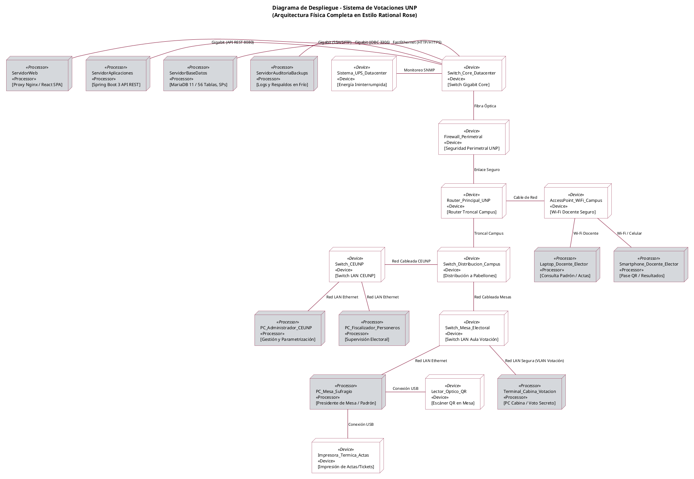
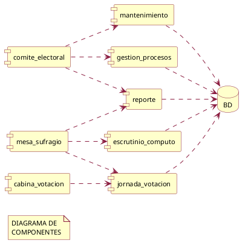

# Documento Maestro de Arquitectura y Despliegue
## Sistema de Elecciones Docentes - Universidad Nacional de Piura (UNP)
### Notación Oficial: Rational Rose / Rational Unified Process (RUP) - UML 1.4

---

## 1. Fundamentos Metodológicos (RUP / Rational Rose)

En la metodología **Rational Unified Process (RUP)** y bajo el estándar de **4+1 Vistas de Arquitectura**, el sistema se modela bajo dos diagramas de implementación y distribución física:

```
                  +---------------------------+
                  |    Vista de Casos de Uso  |
                  |     (El "+1" Central)     |
                  +---------------------------+
                    /                       \
     +---------------------+         +----------------------+
     | Vista de Componentes|         |  Vista de Despliegue |
     | (Módulos de Software|         |  (Hardware, Redes,   |
     |   e Implementación) |         |   Nodos y Topología) |
     +---------------------+         +----------------------+
```

### Reglas Visuales y Semánticas en Rational Rose (UML 1.4):
1. **`<<Processor>>` (Cajas Sombreadas en Gris `#D5D8DC`):** Equipos con capacidad de procesamiento autónomo (CPU) que ejecutan software, hilos y procesos (servidores, computadoras de mesa, cabina táctil, laptops y smartphones).
2. **`<<Device>>` (Cajas Blancas Normales `#FFFFFF`):** Dispositivos de red, infraestructura o periféricos sin capacidad de procesamiento general (switches, routers, firewalls, lectores QR, impresoras, sistemas UPS).
3. **`Connection` (Líneas Continuas):** Medios físicos de conexión (cables Ethernet, fibra óptica, cables USB u ondas de radio Wi-Fi).
4. **`Component` (Rectángulo con 2 pestañas laterales `uml1`):** Módulo de código ejecutable, interfaz o esquema de datos.
5. **`Dependency` (Flecha punteada `..>`):** Relación de uso o llamada entre módulos de software.

---

## 2. Diagrama de Despliegue Físico (Deployment View)

### 2.1 Código PlantUML (Estilo Rational Rose Oficial)
Ubicación del archivo: `diagramas/diagrama_despliegue.puml`



### 2.2 Explicación de las 20 Cajas en 5 Zonas

| Zona | Caja | Tipo | Color | Función en el Sistema |
|---|---|---|---|---|
| **1. Data Center** | `ServidorWeb` | Processor | Gris | Servidor Nginx que entrega el bundle estático de React 19 (SPA) y gestiona SSL/TLS. |
| **1. Data Center** | `ServidorAplicaciones`| Processor | Gris | Backend Spring Boot 3.5.6 (Java 21). Ejecuta reglas de negocio, JWT y valida la cabina. |
| **1. Data Center** | `ServidorBaseDatos` | Processor | Gris | Motor MariaDB 11. Contiene el esquema `elecciones_unp` con 56 tablas, SPs y triggers. |
| **1. Data Center** | `ServidorAuditoriaBackups`| Processor | Gris | Servidor de custodia externa. Almacena respaldos cifrados con AES-256-GCM (`CifradoRespaldo.java`). |
| **1. Data Center** | `Switch_Core_Datacenter` | Device | Blanco | Switch Gigabit central que une los servidores entre sí a 1000 Mbps en red interna. |
| **1. Data Center** | `Firewall_Perimetral` | Device | Blanco | Appliance físico que bloquea ataques externos y solo permite tráfico web seguro (puerto 443). |
| **1. Data Center** | `Sistema_UPS_Datacenter` | Device | Blanco | Batería ininterrumpida que mantiene encendidos los servidores si hay apagones en Piura. |
| **2. Troncal Campus**| `Router_Principal_UNP` | Device | Blanco | Router central del campus. Conecta el centro de cómputo con las facultades e Internet. |
| **2. Troncal Campus**| `Switch_Distribucion_Campus`| Device | Blanco | Switch que distribuye fibra óptica hacia los diferentes pabellones de votación. |
| **3. Sede CEUNP** | `Switch_CEUNP` | Device | Blanco | Switch de red local para la oficina del Comité Electoral Universitario. |
| **3. Sede CEUNP** | `PC_Administrador_CEUNP` | Processor | Gris | PC del Presidente del CEUNP para crear elecciones, subir el padrón y sortear listas. |
| **3. Sede CEUNP** | `PC_Fiscalizador_Personeros`| Processor | Gris | PC de personeros y fiscalizadores para auditar el conteo en tiempo real (solo lectura). |
| **4. Mesas de Voto**| `Switch_Mesa_Electoral` | Device | Blanco | Switch local que interconecta la PC de mesa con la cabina en una red cableada segura. |
| **4. Mesas de Voto**| `PC_Mesa_Sufragio` | Processor | Gris | PC de los miembros de mesa para verificar al docente con su DNI y autorizar la cabina. |
| **4. Mesas de Voto**| `Terminal_Cabina_Votacion`| Processor | Gris | Pantalla táctil en el cubículo secreto. Recibe la elección del profesor de forma 100% anónima. |
| **4. Mesas de Voto**| `Lector_Optico_QR` | Device | Blanco | Escáner USB que lee el código del DNI o pase QR del docente en menos de un segundo. |
| **4. Mesas de Voto**| `Impresora_Termica_Actas`| Device | Blanco | Impresora USB que emite las actas de instalación/escrutinio y la constancia de sufragio con QR. |
| **5. Red Móvil** | `AccessPoint_WiFi_Campus`| Device | Blanco | Antena Wi-Fi colgada en el techo de los pabellones que da internet inalámbrico a los docentes. |
| **5. Red Móvil** | `Laptop_Docente_Elector`| Processor | Gris | Laptop del profesor para consultar días antes el padrón y listas de candidatos. |
| **5. Red Móvil** | `Smartphone_Docente_Elector`| Processor | Gris | Celular del profesor para mostrar su pase electoral QR y ver los resultados en vivo. |

### 2.3 Cómo se ve físicamente el Data Center (El Rack)
Físicamente no son computadoras normales; están montadas en un **Gabinete o Rack de Comunicaciones metálico cerrado con llave**:
- Arriba: Switch Core y Firewall físico.
- Bandejas intermedias: Servidor Web (1U), Servidor de Aplicaciones (1U), Servidor de Base de Datos (2U) y Servidor de Backups (con bahías de discos en RAID).
- Abajo: Baterías del Sistema UPS.
- Todos los servidores se conectan mediante **cables Ethernet Cat 6A en estrella** hacia el Switch Core central.

---

## 3. Diagrama de Componentes (Component View)

### 3.1 Estilo Visual Rational Rose Oficial
Basado exactamente en la notación y paleta de la herramienta Rational Rose:
- **Icono clásico UML 1.4:** Componente rectangular con 2 pestañas laterales (`skinparam componentStyle uml1`).
- **Color de fondo característico:** Amarillo pastel / crema (`#FFFFCC`).
- **Bordes y flechas de dependencia:** Color vino / burgundy (`#8B1C3F`).
- **Base de Datos:** Representada con cilindro (`database "BD"`).
- **Nota de título:** Caja de nota doblada en la esquina superior izquierda.

### 3.2 Código PlantUML - Arquitectura Completa del Sistema
Ubicación del archivo: `diagramas/diagrama_componentes.puml`



### 3.3 Código PlantUML - Estructura Mínima 1:1 (Plantilla de Clase)
Si el profesor solicita replicar exactamente la plantilla simple de 5 cajas vista en clase:

```plantuml
@startuml Diagrama_Componentes_RationalRose_Simple
skinparam backgroundColor #FFFFFF
skinparam shadowing false
skinparam defaultFontName Arial
skinparam defaultFontSize 11
skinparam defaultFontColor #000000

skinparam componentStyle uml1
left to right direction

skinparam component {
  BorderColor #8B1C3F
  BackgroundColor #FFFFCC
  FontColor #000000
  FontSize 11
}

skinparam database {
  BorderColor #8B1C3F
  BackgroundColor #FFFFCC
  FontColor #000000
  FontSize 11
}

skinparam note {
  BorderColor #8B1C3F
  BackgroundColor #FFFFCC
  FontColor #000000
  FontSize 11
}

skinparam arrow {
  Color #8B1C3F
  FontColor #8B1C3F
}

note as N1
DIAGRAMA DE
COMPONENTES
end note

component "comite_electoral" as comite
component "mantenimiento" as mant
component "gestion_procesos" as proc
component "reporte" as rep
database "BD" as bd

comite ..> mant
comite ..> proc
comite ..> rep

mant ..> bd
proc ..> bd
rep ..> bd
@enduml
```



### 3.4 Correspondencia de Componentes con el Código Real
- **`comite_electoral`:** Frontend del Administrador y Miembros del CEUNP (React SPA).
- **`mesa_sufragio`:** Frontend de la PC de Mesa Electoral (Instalación, Asistencia y Cierre).
- **`cabina_votacion`:** Terminal táctil secreta (`/cabina` con `X-Terminal-Secreto`).
- **`mantenimiento`:** Módulo backend de cuentas, roles RBAC, parámetros y seguridad JWT.
- **`gestion_procesos`:** Convocatoria, padrón electoral docente, listas de candidatos y sorteo de miembros.
- **`jornada_votacion`:** Validación de habilitaciones de un solo uso y registro anónimo del voto (`sp_votar_habilitado`).
- **`escrutinio_computo`:** Conteo de votos, resolución de impugnaciones y emisión de actas oficiales.
- **`reporte`:** Generación de actas con código QR (`svgQR`), reportes estadísticos y bitácora de auditoría.
- **`BD`:** Motor MariaDB con el esquema `elecciones_unp` (56 tablas, Stored Procedures y Triggers).

---

## 4. Seguridad, Autenticación y Funcionamiento del Voto

### 4.1 Autenticación Humana vs Autenticación de Dispositivo
* **Para personas (Administrador, Miembros de Mesa, Personeros):** Se utiliza **JWT Bearer**. El usuario inicia sesión en `/api/auth/login`, recibe un token firmado con HMAC-SHA256 y lo envía en la cabecera `Authorization: Bearer <token>`.
* **Para la Cabina de Votación:** El docente **NO inicia sesión**. La cabina se autentica como hardware físico mediante la cabecera **`X-Terminal-Secreto`**. Al conectar la cabina, se genera un código aleatorio de 64 caracteres cuyo hash SHA-256 se guarda en la tabla `terminal_votacion`. Nadie puede enviar votos desde otra computadora sin ese secreto.

### 4.2 Los 3 Estados del Elector: ¿Cuándo se marca que ya votó?
Confirmar la asistencia del docente en la mesa **NO marca que ya votó**. El elector transita por 3 estados:

```
[ 1. PENDIENTE ]          ──> Docente aún no llega a la mesa (ya_voto = 0).
       │ (Mesa verifica DNI/QR)
       ▼
[ 2. HABILITADO / ASISTIÓ ] ──> Se registró en "asistencia_elector". Cabina en espera.
       │                         (ya_voto = 0. NO ha votado aún).
       │ (Docente presiona [Confirmar Voto] en la cabina)
       ▼
[ 3. VOTÓ ]                ──> Se ejecuta "sp_votar_habilitado".
                                Voto entra a la urna y en padrón se marca ya_voto = 1.
```

**¿Por qué está diseñado así?** Si se marcara "ya votó" en la mesa, y el docente sufre una emergencia médica o la pantalla falla antes de votar, perdería su derecho y las actas no cuadrarían con los votos reales de la urna.

### 4.3 La Metáfora del Ticket de Guardarropa (Anonimato del Voto)
¿Cómo sabe el sistema a qué docente ponerle `ya_voto = 1` si la cabina no pide DNI?
1. En la mesa, al docente DOC-40521 se le asigna la **Habilitación temporal N° 958** en la base de datos.
2. A la pantalla de la cabina solo le llega el número `958` (sin nombre ni DNI).
3. El profesor marca la Lista 2 y confirma.
4. La cabina envía al servidor: `"Habilitación 958 votó Lista 2"`.
5. El servidor ejecuta dos acciones independientes en MariaDB:
   - **Acción 1:** `UPDATE padron_electoral SET ya_voto = 1 WHERE id_docente = 40521;`
   - **Acción 2:** `INSERT INTO voto (id_cargo, id_lista, tipo_voto) VALUES (1, 2, 'VALIDO');` *(¡Sin DNI ni habilitación!)*
   - **Acción 3:** `UPDATE habilitacion_terminal SET estado = 'CONSUMIDA' WHERE id_habilitacion = 958;`

### 4.4 El Mito del JSON: ¿Qué viaja por la red?
El JSON que sale de la cabina es estrictamente este (`VotacionDto.java`):
```json
{
  "idHabilitacion": 958,
  "token": "4f9a8b7c2d1e0f3a6b5c4d3e2f1a0b9c8d7e6f5a4b3c2d1e0f9a8b7c6d5e4f3a",
  "votos": [{ "cargoId": 1, "tipo": "VALIDO", "listaId": 2 }]
}
```
* **NO lleva nombre, NO lleva DNI, NO lleva correo.**
* Viaja 100% cifrado por **HTTPS (TLS 1.3)**: un atacante en la red solo ve bytes cifrados incomprensibles.
* Vive solo **5 milisegundos en la memoria RAM** del servidor mientras se ejecuta la transacción SQL y luego es destruido por el recolector de basura de Java sin escribirse jamás en disco duro ni en logs.

### 4.5 ¿Qué guarda la Auditoría (`log_auditoria`)?
Aplica el principio electoral: **Se audita el hecho de votar, jamás por quién se votó.**
* Registra: `id_docente: 40521`, `accion: 'EMITIR_VOTO'`, `detalle_json: '{"id_cargo": 1}'` y firma criptográfica encadenada SHA-256.
* **Nunca registra la lista elegida ni el tipo de voto.**

---

## 5. Bóveda Externa de Auditoría y Respaldos (Disaster Recovery)

### 5.1 ¿Por qué existe un `ServidorAuditoriaBackups` si la BD ya tiene las tablas?
* En el `ServidorBaseDatos`, las 56 tablas siguen vivas y operativas todo el tiempo; nada se borra.
* El `ServidorAuditoriaBackups` es una **Bóveda Digital de Custodia Externa**:
  1. Si se quema el disco del servidor principal o un atacante borra la base de datos con `DROP DATABASE`, la elección se restaura en 2 minutos desde este equipo de respaldo.
  2. Sirve como prueba legal inmutable ante el Jurado Electoral o la ONPE comparando los hashes SHA-256.

### 5.2 La Clave Maestra `RESPALDO_CLAVE` (Zero Hardcoded Secrets)
* Es una clave de mínimo 16 caracteres definida como **Variable de Entorno (`env`)** del sistema operativo.
* **No está escrita en ningún archivo de texto del proyecto** para evitar que se filtre en GitHub.
* El backend Java (`RespaldarBD.java` y `CifradoRespaldo.java`) la toma de la memoria para cifrar los volcados SQL con **AES-256-GCM** (210,000 iteraciones).

### 5.3 El Proceso Inverso de Restauración
```bash
# 1. Definir la clave en la terminal del nuevo servidor:
export RESPALDO_CLAVE="ClaveSecretaEleccionesUNP2026*"

# 2. Descifrar el archivo con la herramienta Java del proyecto:
java -cp elecciones-backend.jar \
  pe.unp.elecciones.electoral.administracion.CifradoRespaldo \
  respaldo_20261118_120000.sql.enc \
  respaldo_recuperado.sql

# 3. Inyectar el SQL plano en MariaDB:
mysql -u root -p elecciones_unp < respaldo_recuperado.sql
```
En menos de 2 minutos, MariaDB reconstruye tablas, índices, votos, actas y procedimientos almacenados.

---

## 6. Redes y Comunicaciones

### 6.1 Router vs Switch vs Access Point vs Firewall
* **Switch:** Conecta equipos por cable **dentro de la misma red local** (une los servidores en el Data Center, o la PC de mesa con la cabina en el aula).
* **Router:** Conecta **redes distintas entre sí** (enruta el tráfico entre los edificios de la universidad e Internet).
* **Access Point:** Es la **antena de radio Wi-Fi colgada en el techo** de los pabellones. Convierte las señales inalámbricas de los celulares en cable de red hacia el switch.
* **Firewall Perimetral:** Es un **equipo físico de hardware en el rack** del Data Center que inspecciona cada paquete y bloquea ataques DDoS, dejando pasar únicamente tráfico web seguro (puerto 443).

### 6.2 ¿Puedo consultar resultados desde mi casa o con datos móviles?
* **Consultar Padrón y Resultados en Vivo (CUS17):** **SÍ, 100% posible desde casa o con datos 4G/5G.** Entra por el Internet público al `Router_Principal_UNP`, pasa el Firewall y el `ServidorWeb` entrega la información sin pedir contraseña.
* **Emitir el Voto:** **NO.** El sufragio es estrictamente presencial en el campus, dentro de la cabina táctil aislada por red cableada.

---

## 7. Documentos Impresos Oficiales (Las 3 Estructuras Visuales)

La impresora de mesa emite documentos formales con texto claro para lectura humana y un **Código QR de Verificación Pública (`/verificar/{token}`)**:

### Estructura 1: Acta de Instalación de Mesa (8:00 AM)
```text
┌─────────────────────────────────────────────────────────────────────────────┐
│ UNIVERSIDAD NACIONAL DE PIURA                                               │
│ COMITÉ ELECTORAL UNIVERSITARIO (CEUNP)                     ┌─────────────┐  │
│ Elecciones Docentes UNP 2026                               │  ██ ▄█ ▀█   │  │
│                                                            │  █▄ █▄ █▀   │  │
│ ACTA DE INSTALACIÓN · MESA N° 05                           │  ▀█ ▄▄ █▄   │  │
│ Fecha: 18/11/2026  |  Hora de apertura: 08:15 AM           └─────────────┘  │
│ Ubicación: Pabellón Central - Aula 102                      [QR VERIFICADOR]│
├─────────────────────────────────────────────────────────────────────────────┤
│ MIEMBROS DE MESA: Presidente, Secretario y Vocal titulares.                 │
│ MATERIAL RECIBIDO: Padrón, 150 Cédulas firmadas por el Presidente, Ánfora.  │
│ FIRMAS: Firmas manuales de miembros de mesa y personeros acreditados.       │
│ Sello digital de integridad: SHA-256: 8a4b2c0f91e3d7a6b5c4... (Inmutable)  │
└─────────────────────────────────────────────────────────────────────────────┘
```

### Estructura 2: Constancia de Sufragio (Durante la Jornada)
```text
┌───────────────────────────────────────────────┐
│        UNIVERSIDAD NACIONAL DE PIURA          │
│       COMITÉ ELECTORAL AUTÓNOMO (CEUNP)       │
│            CONSTANCIA DE SUFRAGIO             │
│ ───────────────────────────────────────────── │
│  Docente:  DRA. ELENA BEATRIZ SOTO CHANG      │
│  DNI:      41298450                           │
│  Mesa N°:  05  |  Hora: 10:24:18 AM           │
│ ───────────────────────────────────────────── │
│              ┌─────────────────┐              │
│              │    ██ ▄█ ▀█     │              │ <--- Código QR oficial
│              │    █▄ █▄ █▀     │              │      de no omiso
│              └─────────────────┘              │
│   "Acredita cumplimiento del deber cívico     │
│    del sufragio conforme al Estatuto UNP."    │
│  * NO VÁLIDO COMO CONSTANCIA DE OPCIÓN POLÍTICA *│
└───────────────────────────────────────────────┘
```

### Estructura 3: Acta de Escrutinio y Cómputo (3:00 PM)
```text
┌─────────────────────────────────────────────────────────────────────────────┐
│ UNIVERSIDAD NACIONAL DE PIURA                                               │
│ COMITÉ ELECTORAL UNIVERSITARIO (CEUNP)                     ┌─────────────┐  │
│ Elecciones Docentes UNP 2026                               │  ██ ▄█ ▀█   │  │
│ ACTA DE ESCRUTINIO Y CÓMPUTO · MESA N° 05                  │  ▀█ ▄▄ █▄   │  │
│ Hora de cierre: 03:00 PM                                   └─────────────┘  │
├─────────────────────────────────────────────────────────────────────────────┤
│ Total de electores hábiles: 150  |  Votaron: 138  |  Ausentes: 12           │
│ RESULTADOS (CARGO: RECTOR):                                                 │
│ • Lista 1 "Dignidad Universitaria": 74 votos                                │
│ • Lista 2 "Innovación y Desarrollo": 58 votos                               │
│ • Votos en Blanco: 4  |  Votos Nulos: 2  |  TOTAL: 138 votos contados       │
│ FIRMAS: Miembros de mesa y personeros de listas.                            │
│ Huella Criptográfica SHA-256 del Acta: c4d8e9f1a2b3... (Bloqueada en BD)   │
└─────────────────────────────────────────────────────────────────────────────┘
```

---

## 8. Guion Resumido para la Defensa Oral del Alumno

Si el profesor te pide explicar el sistema en 1 minuto:

> *"Profesor, el sistema de elecciones de la UNP está diseñado bajo el estándar RUP con arquitectura en N-capas:*
> 1. *En la **Vista de Despliegue**, los equipos se dividen en 5 zonas: Data Center protegido con Firewall físico y UPS; red troncal; Comité Electoral; aulas de votación con PC de mesa y cabina táctil en red cableada aislada; y antenas Access Point para la consulta móvil de los docentes. Las cajas grises son Procesadores con CPU y las blancas son Dispositivos de red y periféricos.*
> 2. *En la **Vista de Componentes**, el Frontend React consume la API REST Spring Boot protegida con JWT Bearer para personas y secreto criptográfico SHA-256 para la cabina (`X-Terminal-Secreto`).*
> 3. *El **Secreto del Voto** se garantiza por disociación en base de datos: la tabla de asistencia registra quién votó, pero el voto se deposita en la urna digital de forma anónima sin DNI ni IP vinculada.*
> 4. *La **Resiliencia ante Desastres** se asegura mediante el servidor de custodia externa, que almacena periódicamente copias de seguridad cifradas con AES-256 (`CifradoRespaldo.java`) usando la clave maestra `RESPALDO_CLAVE` fuera del servidor.*
> 5. *La **Transparencia Pública** permite que cualquier docente o ciudadano consulte los resultados y verifique actas mediante código QR desde su casa a través de Internet."*
