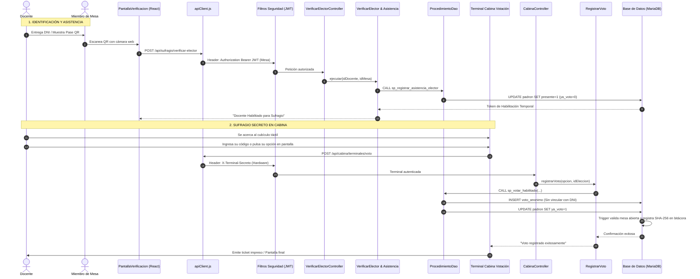

# Guía Didáctica y Detallada del Diagrama de Componentes
## Sistema de Votaciones Docentes UNP (Universidad Nacional de Piura)

> **Archivo del diagrama:** [`diagramas/diagrama_componentes.puml`](file:///c:/Users/rafae/OneDrive/Documentos/Ing%20Informatica/documentos%20personales/carrera/CICLO%20VI/ANALISIS%20DE%20DISE%C3%91O%20DE%20SISTEMAS%20II/sistemaVotaciones/diagramas/diagrama_componentes.puml)  
> **Estilo y Notación:** Rational Rose (UML 1.x) · Paleta oficial crema/guinda · Conexiones ortogonales (`ortho`)  
> **Tecnologías reales modeladas:** React 19 + Vite (Frontend), Spring Boot 3.5.6 / Java 21 (Backend) y MariaDB 10.4+ (Base de Datos).

---

## 1. ¿Qué es este diagrama y para qué sirve?

El **Diagrama de Componentes** muestra cómo está construido el software por dentro a nivel de **módulos de código ejecutables y empaquetados**, cómo se organizan sus carpetas/subsistemas y cómo se comunican entre sí.

En términos sencillos:
* **No muestra servidores físicos ni cables** (eso lo hace el Diagrama de Despliegue).
* **No muestra tablas individuales ni clases a nivel de métodos** (eso lo hacen los Diagramas de Clases o Entidad-Relación).
* **Muestra los "bloques de construcción de software"**: qué pantallas existen en React, qué controladores y servicios atienden las peticiones en Spring Boot, y qué objetos programados viven dentro del motor MariaDB.

---

## 2. Guía Visual: La Notación de Rational Rose (UML 1.x)

Para entender el diagrama a primera vista, es fundamental reconocer las figuras y símbolos que usa Rational Rose:

| Símbolo en el Diagrama | Nombre UML | Significado en Palabras Simples |
| :--- | :--- | :--- |
| **Caja con 2 pestañas a la izquierda** (`componentStyle uml1`) | **Componente** | Es un bloque de código independiente (un archivo `.jsx`, una clase de servicio `.java`, un procedimiento almacenado `.sql` o un ejecutable `.jar`). Las dos pestañas laterales son el ícono clásico de componente en UML 1.x. |
| **Carpeta con lengüeta superior** (`packageStyle folder`) | **Paquete / Subsistema** | Una carpeta o agrupación lógica de componentes relacionados (por ejemplo, todas las pantallas de preparación electoral o todos los filtros de seguridad). |
| **Círculo / Bolita** (`interface`) | **Interfaz REST (Lollipop)** | Un "enchufe" o punto de entrada público que ofrece el Backend. Dice: *"Por aquí puedes pedirme cosas si cumples el formato acordado"*. |
| **Línea sólida continua** (`-`) | **Realización** | Indica quién fabrica o atiende esa interfaz. El controlador backend está "conectado" físicamente a la interfaz porque él implementa ese endpoint. |
| **Línea punteada con flecha** (`..>`) | **Dependencia (`<<use>>`)** | Significa *"El componente A necesita llamar o usar al componente B para funcionar"*. Si el componente B cambia, el componente A se entera. |
| **Líneas rectas en 90°** (`linetype ortho`) | **Trazado Ortogonal** | Conexiones limpias en ángulos rectos, evitando diagonales desordenadas (estilo clásico de diagramación técnica de Rational Rose). |
| **Colores Crema (`#FFFFCC`) y Guinda (`#8B1C3F`)** | **Paleta Rose** | Color representativo de Rational Rose para los módulos (amarillo pastel/crema) con trazos y textos en color vino institucional de la UNP. |

---

## 3. Desglose Detallado: Capa por Capa

El sistema está dividido de arriba hacia abajo en **4 grandes secciones**:

```
┌─────────────────────────────────────────────────────────────┐
│  1. FRONTEND SPA (React 19 + Vite en el Navegador Web)      │
└──────────────────────────────┬──────────────────────────────┘
                               │ (Llamadas HTTP / JSON)
                               ▼
┌─────────────────────────────────────────────────────────────┐
│  2. INTERFACES REST (Los 8 "Enchufes" de Comunicación)      │
└──────────────────────────────┬──────────────────────────────┘
                               │
                               ▼
┌─────────────────────────────────────────────────────────────┐
│  3. BACKEND API REST (Spring Boot 3.5.6 / Java 21)          │
└──────────────────────────────┬──────────────────────────────┘
                               │ (JDBC TCP 3306)
                               ▼
┌─────────────────────────────────────────────────────────────┐
│  4. MOTOR DE BASE DE DATOS (MariaDB 10.4+ / MySQL 8)        │
└─────────────────────────────────────────────────────────────┘
```

---

### PARTE 1: Frontend SPA (`elecciones-frontend` · React 19 + Vite)

Es todo lo que corre en el navegador web del usuario (en las laptops de los miembros de mesa, computadoras del comité, teléfonos de los docentes o pantallas táctiles de la cabina).

#### A. Puntos de Entrada (`main.jsx`)
Son los 3 modos de arranque de la aplicación web:
1. **`App · DashboardPage`:** La aplicación administrativa principal. Requiere usuario y contraseña. Al entrar con sesión JWT, la barra lateral se adapta automáticamente según quién inició sesión (Comité Electoral, Jurado Especial, Miembro de Mesa, Fiscalizador o Personero).
2. **`Cabina en modo kiosko` (`/cabina · TerminalVotacion`):** La pantalla táctil del cubículo de votación. **No pide usuario ni contraseña**; corre en pantalla completa bloqueada y se autentica directamente contra el backend mediante un secreto criptográfico de hardware (`X-Terminal-Secreto`).
3. **`Portal público sin sesión` (`PortalResultados` y `CredencialPublica`):** Cualquier docente o ciudadano desde su casa o celular puede consultar los resultados en vivo (`/resultados`), verificar la autenticidad de un acta escaneando su QR (`/verificar`) o ver su carnet de votación (`/credencial`).

#### B. Módulos de Pantalla (`pages/`)
Son las pantallas visuales agrupadas según la etapa electoral:
* **`UI Acceso y Cuenta`:** Pantallas de inicio de sesión (`LoginPage`), gestión de perfil del docente (`CuentaPage`) y la pantalla forzosa de cambio de contraseña (`CambiarPasswordObligatorio`) para asegurar que nadie vote o administre con claves temporales por defecto.
* **`UI Preparación electoral`:** Utilizado semanas antes de la elección por el Comité Electoral para:
  * Publicar la convocatoria oficial y el cronograma.
  * Cargar el padrón electoral de docentes desde archivos Excel.
  * Inscribir listas de candidatos, recibir tachas ciudadanas y resolverlas.
  * Acreditar a los personeros de cada lista.
  * Ejecutar el sorteo aleatorio de miembros de mesa (titulares y suplentes).
  * Excluir del padrón a docentes con cargos incompatibles (ej. Rector, Vicerrectores).
* **`UI Jornada en mesa`:** Pantallas que utilizan los miembros de mesa el día de las elecciones:
  * `InstalacionMesa`: Apertura de la mesa a las 8:00 AM, registro de asistencia de miembros y verificación del material físico.
  * `PantallaVerificacion`: Escaneo del DNI o credencial QR del docente para habilitarlo a votar.
  * `PantallaCierreSufragio`: Cierre de la mesa a las 4:00 PM y conteo de electores que sufragaron vs ausentes.
* **`UI Escrutinio y Cómputo`:** Pantallas para el escrutinio de votos en la mesa, registro de impugnaciones planteadas por los personeros, resolución de actas observadas por el jurado, cómputo final centralizado y proclamación de ganadores.
* **`UI Multas y Credenciales`:** Generación automática de multas a docentes miembros de mesa que no asistieron o docentes que no votaron; consulta personal de deudas (`MisMultas`) y descarga del pase electoral con QR (`MiPaseQR`).
* **`UI Administración y Bitácora`:** Pantallas exclusivas del Administrador del Sistema para configurar parámetros del servidor, realizar respaldos de la base de datos y revisar la auditoría forense (`PantallaBitacora`).

#### C. Componentes de Apoyo del Frontend
Módulos reutilizables que asisten a todas las pantallas:
* **`apiClient.js`:** Es el "mensajero" oficial del frontend. Envuelve la función `fetch` del navegador. Se encarga de adjuntar automáticamente el token de seguridad `Authorization: Bearer <JWT>` si el usuario está logueado, o la cabecera `X-Terminal-Secreto` si se trata de la cabina. Si el servidor responde con error 401 (no autorizado), este módulo redirige al login.
* **`LectorQR.jsx`:** Componente visual que activa la cámara web o lector óptico, captura cuadros de video en tiempo real y usa la librería `jsQR` para decodificar credenciales o actas.
* **`lib/qrcode.js`:** Librería que dibuja códigos QR vectoriales en pantalla para generar las credenciales y actas imprimibles.
* **`Generadores de documentos`:** Clases JavaScript que formatean e imprimen directamente las actas oficiales (`ActaInstalacion.js`, `ActaEscrutinio.js`), los tickets de constancia de voto y las cédulas de sufragio con códigos de verificación.

---

### PARTE 2: Las 8 Interfaces REST del Backend (El Contrato)

En UML, una **interfaz** es el contrato de comunicación formal: define qué operaciones están disponibles para el mundo exterior. En este sistema corresponden a rutas HTTP sobre HTTPS:

```
[ Frontend: apiClient.js ]
            │
            ├──> (..>) IAcceso           (/api/auth, /api/docente)
            ├──> (..>) IPreparacion      (/api/convocatorias, /api/procesos, /api/padron, /api/listas, ...)
            ├──> (..>) IJornada          (/api/instalacion, /api/mesas, /api/sufragio/**, /api/cierre)
            ├──> (..>) ICabina           (/api/cabina/terminales)  [Requiere X-Terminal-Secreto]
            ├──> (..>) IEscrutinio       (/api/escrutinio, /api/impugnaciones, /api/computo, ...)
            ├──> (..>) IPostElectoral    (/api/multas, /api/credenciales, /api/votos)
            ├──> (..>) IPublico          (/api/publico)            [Abierto sin token]
            └──> (..>) IAdministracion   (/api/administracion, /api/parametros, /api/bitacora, ...)
```

* **Seguridad diferenciada en las interfaces:**
  * **Personas (Comité, Miembros, Docentes):** Se comunican mediante tokens firmados `Authorization: Bearer <JWT>`.
  * **Dispositivo Físico (Cabina de votación):** Se comunica mediante la cabecera fija de hardware `X-Terminal-Secreto`. No hay cuenta humana vinculada.
  * **Portal Público:** No requiere ninguna cabecera; es de libre acceso.

---

### PARTE 3: Backend API REST (`elecciones-backend.jar` · Spring Boot 3.5.6 / Java 21)

Es el núcleo de la aplicación que se ejecuta en el Servidor de Aplicaciones del Data Center.

#### A. Cadena de Filtros de Seguridad (`SEG`)
Toda petición que entra por HTTP pasa obligatoriamente por estos filtros antes de llegar a cualquier controlador:
1. **`LimitePeticionesFilter` (Rate Limiter):** Analiza la dirección IP de origen. Si una computadora intenta hacer 100 peticiones por segundo, la bloquea de inmediato para evitar ataques de denegación de servicio (DDoS) o intentos de adivinar contraseñas por fuerza bruta.
2. **`JwtAuthenticationFilter` + `JwtService`:** Revisa si la cabecera trae un token JWT. Si existe, valida su firma criptográfica (HMAC-SHA256) con la clave secreta del servidor. Si el token expiró o fue manipulado, rechaza la conexión.
3. **`SecurityConfig`:** Configuración global de Spring Security. Define qué rutas están abiertas (`/api/publico/**`, `/api/cabina/**`) y qué roles (RBAC) tienen permiso para invocar cada endpoint (ej. solo el rol `ADMIN_ELECTORAL` puede convocar elecciones).
4. **`UsuarioDetailsService`:** Si el token es válido, busca en la base de datos la cuenta del usuario para cargar sus roles y permisos en el contexto de seguridad de Java.

#### B. Controladores REST (`CTRL` · Capa Boundary)
Son las clases de Java que reciben los JSON por HTTP, validan que los campos no estén vacíos y delegan la ejecución a la lógica de negocio:
* **`AuthController` / `DocentePortalController`:** Inicio de sesión y consulta de datos del docente logueado.
* **`C_PREP` (10 controladores de preparación):** `ConvocatoriaController`, `ProcesoController`, `PadronController`, `InscripcionController`, `TachasController`, `PersonerosController`, `SorteoMesaController`, etc.
* **`C_MESA` (Controladores de jornada):** `InstalacionController`, `MesaController`, `VerificarElectorController`, `CierreController`.
* **`CabinaController`:** Controlador especial que atiende la pantalla táctil de votación. Verifica estrictamente la cabecera `X-Terminal-Secreto`.
* **`C_ESC` (Controladores de escrutinio):** `EscrutinioController`, `ImpugnacionesController`, `ComputoController`, `ResultadosController`.
* **`MultasController` / `CredencialesController`:** Liquidación de multas e impresión de constancias.
* **`PublicoController`:** Endpoints de solo lectura para los resultados públicos.
* **`AdministracionController` / `AuditoriaController`:** Endpoints para crear usuarios del sistema y auditar eventos.

#### C. Lógica de Negocio (`CONTROL` · Casos de Uso y Servicios)
El sistema aplica el patrón de arquitectura limpia: **una clase Java por cada Caso de Uso**, lo que evita archivos gigantes y garantiza que cada regla electoral esté aislada:
* **`RegistrarProceso`, `AgregarCargo`, `PublicarConvocatoria`:** Reglas para aperturar una elección.
* **`ImportarDocentes`, `FiltrarHabilitados`, `AprobarPadron`:** Valida que el docente pertenezca a la UNP, esté activo y no tenga suspensión.
* **`InstalarMesa`, `VerificarMaterial`, `RegistrarLlegadaMiembro`:** Exige quórum de 3 miembros para declarar abierta la mesa.
* **`VerificarElector`, `RegistrarAsistencia`:** Marca la asistencia del docente en la mesa física y emite una habilitación temporal de un solo uso para que pase a la cabina.
* **`RegistrarVoto` (Votación Secreta):** Es el corazón del sistema. Guarda el voto de manera completamente disociada del elector para preservar el **secreto del voto**. Registra la opción elegida sin saber quién fue, y en otra tabla marca que la credencial del elector ya fue consumida.
* **`ConciliarVotos`, `GenerarActaEscrutinio`:** Realiza la conciliación matemática: `Votos por Listas + Votos Blancos + Votos Nulos = Total de Ciudadanos que Votaron`. Si no cuadra, genera una observación en el acta.
* **`Bitacora`:** Componente transversal. Cada vez que se ejecuta una acción clave (sorteo, anulación de voto, cierre de mesa), este componente registra un evento inmutable con la IP, usuario, hora exacta y hash del cambio en la tabla `log_auditoria`.

#### D. Acceso a Datos (`DATOS`)
* **`ProcedimientoDao`:** Utiliza `JdbcTemplate` para ejecutar directamente los **Procedimientos Almacenados** de MariaDB. Se usa para las transacciones electorales críticas donde se requiere máxima velocidad, transaccionalidad ACID y ejecución dentro del motor de base de datos.
* **`Repositorios Spring Data JPA` (14 repositorios):** Clases (`UsuarioRepository`, `DocenteRepository`, etc.) para operaciones de lectura/escritura sencillas (CRUD) que no requieren lógica matemática compleja.
* **`HikariCP`:** Es el gestor de conexiones (Pool de conexiones). Mantiene abiertas 20 a 50 conexiones hacia MariaDB para no perder tiempo abriendo y cerrando conexiones TCP en cada voto.
* **`Carpeta respaldos/*.sql.enc`:** Almacén seguro donde el caso de uso `RespaldarBD` guarda copias de seguridad de la base de datos cifradas con el algoritmo militar **AES-256-GCM**.

---

### PARTE 4: Motor de Base de Datos (`BD` · MariaDB 10.4+ / MySQL 8)

A diferencia de sistemas convencionales donde la base de datos es solo un almacén pasivo, en este sistema la base de datos **elecciones_unp** es un motor activo con reglas de negocio reforzadas:

```
                          [ JDBC / TCP 3306 ]
                                   │
         ┌─────────────────────────┼─────────────────────────┐
         ▼                         ▼                         ▼
┌──────────────────┐      ┌──────────────────┐      ┌──────────────────┐
│ 80 Procedimientos│      │    35 Vistas     │      │    59 Tablas     │
│   Almacenados    │      │   de Consulta    │      │  Relacionales    │
│   (sp_votar, ...)│      │   (vw_padron,...)│      │(mesas, votos,..) │
└────────┬─────────┘      └────────┬─────────┘      └────────┬─────────┘
         │                         │                         │
         │                         ▼                         │
         │                Lectura Optimizada                 │
         ▼                                                   ▼
   Modifica Tablas ────────────────────────────────────> Triggers (82)
                                                             │
                                                             ▼
                                                    Registra en Cadena
                                                             ▼
                                                   ┌──────────────────┐
                                                   │  log_auditoria   │
                                                   │ (Sellos SHA-256) │
                                                   └──────────────────┘
```

1. **80 Procedimientos Almacenados (`SP`):**  
   Encapsulan los procesos atómicos más importantes (ej. `sp_votar_habilitado`, `sp_cerrar_sufragio`, `sp_computo_final`). Al ejecutarse directo en MariaDB, garantizan que dos personas votando en el mismo milisegundo jamás corrompan los totales ni generen bloqueos de base de datos.
2. **35 Vistas de Consulta (`VW`):**  
   Consultas SQL optimizadas (ej. `vw_resultados_en_vivo`, `vw_docentes_habilitados`). Permiten que el portal público lea resultados en tiempo real sin tocar ni exponer directamente las tablas de votos o contraseñas.
3. **82 Triggers (Disparadores Automáticos):**  
   Reglas de seguridad obligatorias que se ejecutan automáticamente ante cualquier `INSERT`, `UPDATE` o `DELETE`:
   * Impiden que una mesa se instale dos veces.
   * Impiden que se modifique un voto ya registrado.
   * Impiden registrar un voto si la mesa figura como "Cerrada".
   * Forzan que cualquier modificación en usuarios o configuraciones quede grabada en la auditoría.
4. **11 Funciones Criptográficas (`FN`):**  
   Funciones internas como `fn_bytes_aleatorios`, generación de identificadores únicos para las actas y cálculos de dispersión para anonimizar el voto.
5. **59 Tablas Relacionales (`TBL`):**  
   Estructura que almacena los procesos electorales, las listas de candidatos, los miembros de mesa asignados por sorteo, las opciones de voto emitidas y las multas.
6. **Tabla `log_auditoria` (Cadena Criptográfica):**  
   Registro forense especial. Cada fila guarda un hash **SHA-256** calculado con los datos del registro actual más el hash del registro anterior. Esto forma una **cadena inmutable (estilo blockchain liviano)**: si un administrador malicioso entra por consola e intenta alterar o borrar una fila del pasado, todos los sellos siguientes se rompen, evidenciando el fraude en la auditoría.

---

## 4. Ejemplo Práctico: El Flujo Real de un Voto

Para ver cómo interactúan todos los componentes en la vida real, sigamos el camino de un docente al emitir su voto:



### Lo que demuestran los componentes en este flujo:
1. **El Miembro de Mesa nunca toca la cabina de votación:** Usa `PantallaVerificacion` con sesión JWT.
2. **El Docente nunca escribe su nombre en la cabina:** La cabina emite el voto usando su propio secreto `X-Terminal-Secreto`.
3. **El voto es 100% anónimo:** La base de datos actualiza que el docente estuvo presente, pero la fila donde se incrementa el voto no guarda ninguna relación con su número de DNI.
4. **La auditoría es automática:** El trigger de la base de datos sella el evento en `log_auditoria` sin intervención humana.

---

## 5. Preguntas Frecuentes para Sustentaciones

### ¿Por qué el Frontend se conecta a través de Interfaces REST y no directo a la Base de Datos?
> **Respuesta:** Por seguridad y separación de responsabilidades. Si el frontend React se conectara directamente a MariaDB, las contraseñas de la base de datos quedarían expuestas en el código JavaScript del navegador del usuario. Además, el backend Spring Boot actúa como un filtro protector que valida la identidad del usuario, aplica los límites de peticiones por segundo y hace cumplir las reglas de negocio antes de llegar a la base de datos.

### ¿Qué diferencia hay entre la cabecera `Authorization: Bearer <JWT>` y `X-Terminal-Secreto`?
> **Respuesta:** `Authorization: Bearer <JWT>` identifica a una **persona humana** (un administrador o miembro de mesa que inició sesión con usuario y clave). `X-Terminal-Secreto` identifica al **hardware de la cabina de votación**, un dispositivo físico en el cual los electores votan en secreto sin iniciar sesión con credenciales personales.

### ¿Por qué se usan Procedimientos Almacenados en lugar de solo JPA?
> **Respuesta:** Para operaciones transaccionales críticas (como registrar un voto o cerrar una mesa electoral con cómputo de actas), los **80 Procedimientos Almacenados** garantizan transaccionalidad ACID directa en el motor, evitando problemas de concurrencia y asegurando que las reglas no puedan ser alteradas por ningún cliente externo.

### ¿Cómo garantiza el diagrama que nadie pueda falsificar la bitácora de auditoría?
> **Respuesta:** El componente `Bitacora` en conjunto con los triggers de MariaDB registran cada movimiento en la tabla `log_auditoria`. Cada registro incluye un hash SHA-256 que enlaza con el registro anterior, formando una cadena inmutable verificable mediante el endpoint `/api/auditoria/verificar`. Si alguien edita una fila manualmente por consola, la cadena queda rota y el sistema alerta de fraude.

---

### Archivos de Referencia en el Proyecto:
* **Diagrama PUML:** [`diagramas/diagrama_componentes.puml`](file:///c:/Users/rafae/OneDrive/Documentos/Ing%20Informatica/documentos%20personales/carrera/CICLO%20VI/ANALISIS%20DE%20DISE%C3%91O%20DE%20SISTEMAS%20II/sistemaVotaciones/diagramas/diagrama_componentes.puml)
* **Arquitectura Completa y Despliegue:** [`documentacion/ARQUITECTURA_Y_DIAGRAMAS_RATIONAL_ROSE.md`](file:///c:/Users/rafae/OneDrive/Documentos/Ing%20Informatica/documentos%20personales/carrera/CICLO%20VI/ANALISIS%20DE%20DISE%C3%91O%20DE%20SISTEMAS%20II/sistemaVotaciones/documentacion/ARQUITECTURA_Y_DIAGRAMAS_RATIONAL_ROSE.md)
